# POCP: Proof of Change Protocol

POCP checks that the tests a pull request was supposed to pass actually ran, on the exact code being merged, under rules the pull request can't change. When a pull request edits existing tests, it runs the old tests on the new code, and holds risky test edits for human review. An optional deep mode also compares the old and new tests against a sample of planted bugs. It works with any test command and any language, and needs only Node 20 or later and git.

It doesn't prove your code is correct. It's also early: the results below come from a scripted test suite and small pilots, not a completed evaluation. To install it, see [How to try it](#how-to-try-it).

## Demo

An agent edits a failing test until CI turns green. POCP runs the old test against the new code and routes the suspicious change to human review.



To run it from a clone: `node examples/demo/demo.mjs`. It takes a few seconds and shortens POCP's output; `--keep` leaves the scratch repository so you can see everything.

## Why this exists

I started building with AI coding agents without knowing much about software, and I still can't read the code they write, not at the scale they write it. That left one question I couldn't let go of: if I can't read it, how do I trust it? How do I know a change does what I meant, doesn't quietly break something, and doesn't fake its way past the tests?

POCP is my answer. Instead of trusting a sentence an agent typed ("tests pass"), it records proof: the checks that ran, on the exact code that was committed, under rules the change itself can't loosen. Then it checks that proof again in CI.

I'm testing POCP with separate benchmarks and a reference checker that shares no implementation code with POCP. So far, only pilots have run. No counted evaluation exists, and the pre-registration is unfinished. The results and their limits are linked below.

## What it does

A rule in `.proof/rules.json` says which files need which checks:

```json
{
  "pocp": 1,
  "requirements": [
    { "id": "billing-tests", "globs": ["src/billing/**"],
      "obligation": { "kind": "test", "run": "node --test test/billing.test.js" } }
  ]
}
```

A check is any command, such as `npm test`, `pytest`, `cargo test`, `go test ./...` or `make check`.

Locally, a git hook blocks a commit that touches `src/billing/**` until a packet records that `node --test test/billing.test.js` passed on exactly the staged code. `pocp fix` runs the checks and writes the packet, and the commit gets a trailer that points to it:

```
Proof-Of-Change: p-2f007850 subject=sha256:2ad8c12023b7 policy=sha256:f21acbea749e proven=1/1 attested=0/0
```

In CI, `pocp verify origin/main..HEAD --require-coverage --rerun` (the base branch, then the pull request's head):

- re-runs every required check itself, instead of trusting the packets, which are only pointers;
- judges the pull request by the base branch's rules, so the pull request can't remove or loosen a rule or add its own signing key;
- when the pull request edits existing tests or test setup, runs the test check once, on the pull request's net change, so a weakening split across commits or placed in a merge commit is judged the same way. It has two modes (below);
- fails with a named reason, and says when only a maintainer can resolve it, for example by approving an intended test change with a label. On GitHub, a separate trusted workflow turns that into one commit status, **`pocp`**: green when verified, yellow while it waits for a maintainer or a check didn't finish, red on a real failure ([docs/STATUS.md](docs/STATUS.md)).

### The test check: fast and deep

Both modes first run the old versions of the edited tests on the new code. If they run to the end and fail, but pass on the base, behavior changed, and a person approves it. If they don't finish (a timeout, for example, under load), the result is inconclusive rather than a behavior change, and it still needs a re-run or a person.

- **Fast** (`guard.mutants: 0`, what `pocp init` sets up). No test edit passes on its own: every change to tests or test setup goes to a person, including added lines and new test files. Text rules can't tell whether an edit still tests what it did (added lines alone can disable existing assertions), so fast mode doesn't pretend to. Its review lists what changed and flags added lines that match common risky patterns (skipping or focusing tests, exiting, early returns, patched assertions, mocking APIs, exit-code resets, test hooks, globals, empty `catch`) so the reviewer knows where to look first.
- **Deep** (`guard.mutants: 10`, `pocp init --deep`). The only mode where a test edit can pass without a person. POCP plants a sample of small bugs (flipped comparisons, swapped operators, changed constants) and checks that the new tests catch every sampled bug the old tests caught. New test files count too: they run with the old ones, so one that exits early or patches an assertion makes the suite miss bugs it caught. It samples: a weakening that matters only outside the sample passes, and only the bug types POCP can plant are tried. On POCP's own code, about 14% of StrykerJS's mutants are edits POCP's operators can make. It is much slower (below).

A project set up before fast mode existed, with no `guard.mutants` in its config, keeps deep mode: the built-in default is still 10, and upgrading POCP never rewrites a config. To switch such a project to fast mode, set `"guard": { "mutants": 0 }` in `.proof/config.json` in a pull request of its own. Lowering `guard.mutants` is a policy change, so CI fails it until a maintainer approves it with the `pocp-approve-policy` label.

Within the limits in [docs/THREAT-MODEL.md](docs/THREAT-MODEL.md):

| Change | Plain CI | Fast mode | Deep mode |
|---|---|---|---|
| Deletes or weakens a failing assertion | passes | blocked if the old tests run to the end and fail on the new code; otherwise the edit goes to a person | blocked if the old tests run to the end and fail on the new code, or a sampled bug goes undetected |
| Marks tests skipped or `.only` | passes | goes to a person | blocked if a sampled bug goes undetected |
| Hollows out the test script, runner config, or an assertion helper the tests import | passes | goes to a person, for helpers POCP finds by following imports | blocked, for helpers POCP finds by following imports |
| Adds a test file, or lines to a test, that disable other tests | passes | goes to a person | blocked if a sampled bug goes undetected |
| Removes or loosens the rule that requires a check | n/a | blocked: the base branch's rules apply | same |
| Edits a packet so failing proofs read as passed | n/a | blocked: the checks are re-run | same |
| Edits or removes POCP's CI workflow | passes | with `pocp` required: stays yellow until a maintainer approves the workflow change (`pocp-approve-workflow`); see the limit below | same |
| Writes code that special-cases the test inputs | passes | not blocked | not blocked |

"Goes to a person" means the change waits until a maintainer approves it with a label. With the `pocp` status that's a yellow wait, not a red ✗. In fast mode every test edit is reviewed. In deep mode an edit passes without review only when the sampled bugs show no loss, which is evidence, not a proof that the tests are as strong as before.

## What it doesn't do

- It doesn't judge whether code is honest. Code written to pass the specific test inputs passes every mechanical check.
- It doesn't enforce merges. `verify` fails a check; whether a failing check blocks the merge is your Git host's setting (on GitHub, branch protection).
- It can't fully stop a pull request from faking its own check. A pull request runs its own copy of the workflow. With the `pocp` status required, a pull request that edits CI files stays yellow until a maintainer approves the edit, and pull requests from forks can't post a status at all. But a branch pushed to your repository by someone with write access, including an agent using your token, can edit its workflow to post its own `pocp` status. Read the diff of any such pull request that touches `.github/` ([docs/STATUS.md](docs/STATUS.md#a-limit-of-the-pocp-status)). A dedicated GitHub App for the reporter, which would close this, is planned.
- It doesn't measure new tests. The test check compares a change with tests that already existed, so a weak test added in the same pull request isn't measured.
- It isn't hermetic. Checks can read the network, environment variables and installed packages, and the re-runs execute the pull request's code in your CI job.
- It adds CI time. `verify` re-runs your required checks, so each pull request costs about one extra test run, in parallel with your other jobs. On POCP's own pull requests in fast mode, `verify` took 3 to 4 minutes next to test jobs of 3 to 4 minutes, and 10 to 11 minutes when several commits edited tests, because the old tests ran as the whole suite. A rule's `changed_test_command` runs only the edited test files instead ([docs/REFERENCE.md](docs/REFERENCE.md#faster-test-edits-changed_test_command)). It hasn't been measured on other projects yet.
- Deep mode is slow. It re-runs the required checks for each planted bug, so its cost grows with your suite's run time. On POCP's own repository it took up to about 17 minutes locally. One measured case: on 2026-11-02, a full `verify` of a 13-commit pull request to POCP that edited test helpers took about 25 minutes on a GitHub runner, of which the test check took about 16 ([run](https://github.com/harriswekselblatt/pocp/actions/runs/41524329250)).
- A process a check starts in a new session (`setsid`, a daemon) can outlive the check.
- Native Windows isn't supported. The hooks and checks need a POSIX shell: Linux, macOS, or Windows through WSL.

## How to try it

POCP needs Node 20 or later, git and a POSIX shell. Your project can be in any language. In a git repository:

```bash
npm install --save-dev "github:harriswekselblatt/pocp#v1.1.1"
npx pocp init --hooks --github
```

`init` creates `.proof/` and reports where it found your tests. `--hooks` installs the git hooks; hooks you already have keep running. `--github` writes three workflows to `.github/workflows/`, pinned to this release:

- `pocp.yml` runs verify;
- `pocp-status.yml` sets the `pocp` status;
- `pocp-labels.yml` removes approval labels on every push.

Then:

1. **Say what must be proven.** Add a rule to `.proof/rules.json` (above). Change a file it covers, and commit. If the commit is blocked, run `npx pocp fix --intent "<what the change does>"` and commit again. Anyone can skip the hook with `git commit --no-verify`; CI then flags the commit as made without its proof.
2. **Check the setup:** `npx pocp doctor`. It lists anything missing, with the commands to fix it, such as the approval labels to create on GitHub. Pushing the workflow files needs a GitHub login with the `workflow` permission.
3. **Try it in report-only mode.** Require the `verify` check on your main branch, and watch the `pocp` status on a few pull requests. `npx pocp ci required --apply` sets branch protection from `.proof/config.json`: the required checks, pull requests only, admins included, and branches up to date before merging, so the code that merges is the code that was verified. Each can be turned off, and `pocp doctor` reports any gap. On a free plan's private repository GitHub has no branch protection, so POCP can only report there. Merge queues (GitHub's, Graphite's) aren't supported yet ([docs/REFERENCE.md](docs/REFERENCE.md)).
4. **Go live, in one sitting:** set the repository variable `POCP_STATUS_LIVE` to `true`, *and* require `pocp` instead of `verify` (in Settings → Branches; `pocp ci required --apply` only ever adds checks, never removes one). A wait for approval then shows yellow, with no red ✗ and no failure email, and merging stays blocked until the approval. To roll back, unset the variable and require `verify` again.

[docs/QUICKSTART.md](docs/QUICKSTART.md) walks through this on a non-JavaScript project. [docs/STATUS.md](docs/STATUS.md) covers the status, the approval labels, who may approve, and its limits.

**On another CI** (GitLab, Jenkins, plain shell). In CI: keep your existing test step, and add:

```bash
npx pocp verify origin/main..HEAD --require-coverage --rerun
```

This needs the base branch fetched with its history. [`examples/`](examples/) has complete workflows for GitLab and plain shell.

This repository uses POCP on itself: every pull request needs the `pocp` status, plus the test suite on Ubuntu with Node 20, 22 and 24 and the eval tests. The test suite also runs on macOS (one Node version on each pull request, all three nightly), which is not required while GitHub's macOS runners are unreliable.

## Results so far

None of these is a completed evaluation. The pre-registration ([eval/PREREG.md](eval/PREREG.md)) is unfinished, and no counted run exists. The plan is in [docs/EVAL-PLAN.md](docs/EVAL-PLAN.md).

These results were all measured in deep mode (`guard.mutants: 10`), before fast mode existed. They don't describe fast mode, which hasn't been benchmarked yet.

Scripted test suite ([bench/tamper/RESULTS.md](bench/tamper/RESULTS.md)): 79 scripted scenarios on POCP's own repository, in deep mode with the other settings at their defaults unless noted.
- 73 of them plant a bug. Of those, 52 also cheat in a way that makes plain CI pass, and `verify --rerun` blocked all 52.
- The other 6 are honest changes, and POCP blocked none of them.
- In the optional `attest` mode, the author of a test change can approve it themselves, which is a weaker approval model than the default (a maintainer's approval). The same suite in `attest` mode blocked 33 of the 52 cheats.
- The cheats are scripted and the bugs come from POCP's own mutation operators, so this tests known cases and is not independent evidence.
- The latest run (2026-11-02, at commit `b50ece4`) was a same-seed re-run of the earlier one. It planted the same three bugs, and every scenario's outcome was unchanged. It is not a new sample and not independent validation. Its proof record checks only that `RESULTS.md` matches the raw results file, not that the benchmark itself is correct.

Pilots ([eval/](eval/)) are small runs to size the study. None is compared with a pass bar.
- On impossible coding tasks ([ImpossibleBench](https://arxiv.org/abs/2510.20270)), the Codex and Claude pilots produced too few comparable cheats to support any catch-rate claim. Many Claude runs ended in usage-limit errors. The details, including which cheats were blocked and which shipped, are in [eval/e1/RESULTS.md](eval/e1/RESULTS.md).
- On 10 solvable tasks, Codex solved all 10, and POCP blocked none of the solutions.
- On 16 StrykerJS mutants of POCP's own code, both Stryker and POCP's checks caught the same 13 and missed the same 3. That is a small pilot; agreement doesn't show either result is correct ([eval/e3/RESULTS.md](eval/e3/RESULTS.md)).
- In POCP's own development, 7 of 45 commits that touched guarded files passed the gate on the first try. The median time from a block to a pass was about 2 minutes. That is elapsed time, including the agent's own time between commands, not just POCP's run time ([eval/e5/RESULTS.md](eval/e5/RESULTS.md)).

## Documentation

- [docs/REFERENCE.md](docs/REFERENCE.md): rules, checks, run modes, CI options, approvals, signed proofs.
- [SPEC.md](SPEC.md): the protocol. [test/vectors.json](test/vectors.json) has the hashes any implementation must produce.
- [docs/THREAT-MODEL.md](docs/THREAT-MODEL.md): what each record does and doesn't prove.

## License

MIT. See [LICENSE](LICENSE).
