# POCP: Proof of Change Protocol

POCP checks that the tests a pull request was supposed to pass actually ran, on the exact code being merged, under rules the pull request can't change. When a pull request edits existing tests, it runs the old tests on the new code and holds risky test edits for a maintainer. It works with any test command and any language, and needs only Node 20 or later, git and a POSIX shell.

It doesn't prove your code is correct. It has one evaluation so far ([below](#evaluation)).



An agent edits a failing test until CI turns green. POCP runs the old test against the new code and holds the change for a person. Rather than wait for that approval, the agent puts the test back and fixes the code, and the pull request verifies. Run it from a clone with `node examples/demo/demo.mjs`.

## Install

```bash
npm install --save-dev proof-of-change
npx pocp init --hooks --github
```

`--github` needs a GitHub `origin` and `gh` logged in with the `workflow` scope (`gh auth refresh -s workflow`). Before you push, set your toolchain and install command in `.github/workflows/pocp.yml` (the lines marked ▶): CI runs every check on a fresh machine. No CI? Use `npx pocp init --local` (below).

`init` creates `.proof/` and installs git hooks (yours keep running). Then:

1. **Say what must be proven.** A rule in `.proof/rules.json` maps files to a check, which is any command (`npm test`, `pytest`, `go test ./...`):

   ```json
   { "pocp": 1, "requirements": [
     { "id": "billing-tests", "globs": ["src/billing/**"],
       "obligation": { "kind": "test", "run": "node --test test/billing.test.js" } } ] }
   ```

2. **Commit.** If the hook blocks it, run `npx pocp fix --intent "<what the change does>"` and commit again. The commit gets a `Proof-Of-Change` trailer.
3. **Check the setup** with `npx pocp doctor`, which prints the commands for anything missing.

**Upgrading.** `npx pocp upgrade --dry-run` shows what a newer release would change; `npx pocp upgrade` bumps the dependency (or the global install), re-pins the GitHub workflows to the new release and says which approvals the pull request needs. POCP never checks for updates in the background: `pocp doctor` notes, from local files, when the hooks and CI run different releases, and only `pocp upgrade` asks the npm registry ([docs/REFERENCE.md](docs/REFERENCE.md#upgrading)). From 1.4, which has no `upgrade`, see that section first.

## Where the checks run

**GitHub CI** (`--github`, above). Run it once the GitHub repository exists, `origin` points at it and `gh` is logged in: `init` then writes the workflows, creates the approval labels and turns on the `pocp` status, which is green when verified, yellow while waiting for a maintainer's approval label and red on a real failure ([docs/STATUS.md](docs/STATUS.md)). Once the workflows are merged, `npx pocp ci required --apply` makes GitHub block merges until `pocp` is green. CI re-runs every check on a clean machine, and approvals are a maintainer's label. The trade: each pull request costs about one extra test run of Actions minutes, and on a free plan's private repository nothing blocks a merge.

**Local mode, no CI.** `npx pocp init --local` instead of `--github`, or `npx pocp ci off` on a repository that already has the workflows (`pocp ci on` reverses it). The git hooks are the gate and CI costs nothing. The trade: nothing re-runs the checks on another machine, nothing blocks a merge, and `git commit --no-verify` skips the gate unless you run `npx pocp verify --require-coverage --rerun main..HEAD` before you merge. Approvals are `--accept-*` flags on that command, so anything that can run commands on your machine, an agent included, can give them. `pocp doctor` suggests it when Actions jobs aren't starting for billing reasons. In local mode, `pocp ci off` and `pocp doctor` also find your other workflows that fail only because GitHub doesn't start their jobs for billing (no Actions minutes left, or a spending limit reached), and list each one with its latest run and GitHub's message. They then ask once before disabling them on GitHub. The workflow files stay as they are, and `gh workflow enable <file>` turns each back on. Without a terminal, or with `--json`, they only report, unless you pass `--disable-billing-failed`.

**The reporter's own GitHub App** (optional, on top of GitHub CI). By default the `pocp` status is posted as GitHub Actions, like any workflow, so a branch pushed to your repository, by an agent using your token for example, can edit a workflow and post its own `pocp: success`. Giving the reporter its own App, with its key in an environment only the default branch can use, and requiring `pocp` from that App closes this. The trade: three setup steps, and it needs a public repository or GitHub Pro or Team ([docs/STATUS.md](docs/STATUS.md#give-the-reporter-its-own-identity)).

**On another CI** (GitLab, Jenkins, plain shell). In CI: keep your existing test step, and add:

```bash
npm install --prefix "$HOME/.pocp" --no-save --ignore-scripts proof-of-change@1.5.0
node "$HOME/.pocp/node_modules/proof-of-change/bin/pocp.js" verify origin/main..HEAD --require-coverage --rerun
```

Install the verifier outside the checkout and run it with `node`, as the GitHub workflow does. Not `npx pocp` from inside it: the pull request controls the checkout's `package.json`, `.npmrc` and `node_modules`, so npx would run whatever `pocp` the pull request ships.

[docs/QUICKSTART.md](docs/QUICKSTART.md) walks through all of this on a non-JavaScript project.

## With Claude Code, Codex, Cursor and pre-commit

**Claude Code.** Install the plugin:

```text
/plugin marketplace add harriswekselblatt/pocp
/plugin install pocp@pocp
```

Run `/pocp:setup` in a repository that doesn't use POCP yet: Claude finds your test command, asks where the checks should run, installs POCP and writes a first rule, asking before it commits or pushes. In a repository that uses POCP, the plugin stops Claude from going around it: no `git commit --no-verify` or `core.hooksPath` change to skip the gate, no force-push over proven commits, no approving its own test or policy change (adding a `pocp-approve-*` label, `pocp approve`, `--accept-*`), and no switching checks off on GitHub without a pull request (`pocp ci off`, `pocp init --local`, `gh workflow disable`, `--disable-billing-failed`). Each refusal tells Claude what to do instead. When a command's output shows POCP holding a change for you, the plugin gives Claude POCP's full plain-English reason, so Claude tells you the exact command, what the label means and why this change needs it, never just the 140-character status line. It also teaches Claude the POCP workflow. It guards against an agent cutting corners, not one set on hiding what it does; CI is still the check.

**Codex, Cursor and other agents.** Paste [examples/agent-instructions.md](examples/agent-instructions.md) into the agent's instructions: `AGENTS.md` for Codex, a file in `.cursor/rules/` for Cursor. Instructions guide the agent; the git hooks and CI enforce.

**pre-commit.** If you manage hooks with [pre-commit](https://pre-commit.com), use POCP's hooks instead of `pocp init --hooks`:

```yaml
default_install_hook_types: [pre-commit, prepare-commit-msg, post-commit]
repos:
  - repo: https://github.com/harriswekselblatt/pocp
    rev: v1.5.0
    hooks: [{ id: pocp-gate }, { id: pocp-trailer }, { id: pocp-land }]
```

Then `pre-commit install`. `pocp doctor` recognises them.

## Evaluation

A benchmark of POCP 1.2.3 on p-map (JS), boltons (Python) and gjson (Go): 180 cases and 1,260 runs, 68 of the cases held out until the scoring script was locked ([full report](eval/campaign-123/README.md)). The protocol was frozen by hash before the runs. The freeze record isn't public, so that order rests on my account. The raw records and the scripts that score them are public in [pocp-eval](https://github.com/harriswekselblatt/pocp-eval).

- **Harmful changes (48):** each breaks the code, then hides it with one of four scripted edits to the test that caught it: delete the assertion, empty the assertion helper, overwrite the expected-value fixture, or make the check script exit 0. Plain CI accepted all 48. POCP accepted none: in both modes it held each one for a person, with the old tests failing on the new code. That shows the old-tests check works on each part of a suite in three languages. It doesn't measure cheats that leave the old tests passing (no harmful case reached deep mode's planted bugs), or deliberate deception across pull requests ([threat model](docs/THREAT-MODEL.md)).
- **Honest changes (108):** deep mode accepts 78–82% per seed, and 86–88% without the 24 paired controls built to resemble cheating. It sends the rest to review. Fast mode reviews every test edit by design, so it accepts 27%, about what a rule holding every test-file edit would. Reducing that friction is the next piece of work.

## Why not just require review of test files?

Fast mode is close to that rule, with two differences. The reviewer gets evidence, not just a diff: POCP runs the old tests on the new code and names any that now fail. And what must pass is set by the base branch, so a pull request can't get green by changing its rules, its check command, its test script or its runner config. Deep mode goes further: its planted bugs let most honest test edits through with no person.

## Documentation

- [How it works](docs/HOW-IT-WORKS.md): what it catches, fast and deep modes, and what it doesn't do.
- [Evaluation of 1.2.3](eval/campaign-123/README.md): the benchmark. [Results](docs/RESULTS.md): the counted ImpossibleBench run on 1.5.0, scripted suites and pilots.
- [Reference](docs/REFERENCE.md): rules, checks, CI options, approvals, signed proofs.
- [Threat model](docs/THREAT-MODEL.md): what each record does and doesn't prove.
- [SPEC.md](SPEC.md): the protocol. [Reviewing POCP](docs/REVIEWING.md): a guide for reviewers.

## Why this exists

I build with AI coding agents and can't read their code at the scale they write it. POCP records proof instead of trusting a sentence like "tests pass": the checks that ran, on the exact code committed, under rules the change can't loosen, checked again in CI.

## License

MIT. See [LICENSE](LICENSE).
